# Flow past a cylinder on the GPU

A CUDA lattice Boltzmann solver, validated against the DFG cylinder benchmark and running in real time on a laptop GPU.

 &nbsp; Try it on Windows without installing anything: [download the release](https://github.com/hitesh100299/GPU-Lattice-Boltzmann-Method/releases/latest).

  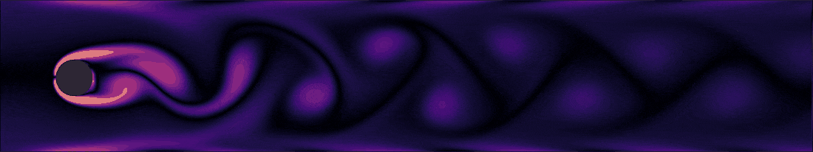

<i>Re = 100, Schäfer and Turek case 2D-2, 80 cells per cylinder diameter: two shedding periods from the demo's headless build, with the same kernels and colour map as the window (<a href="cuda/results/demo_gui/summary.json">source</a>)</i>

| Validation error at the finest grid | Solver speed | Demo frame rate |
|:---:|:---:|:---:|
| Strouhal number and pressure difference within 0.1 % of the reference, drag peak within 0.62 %, lift peak within 1.5 % ([2D-2, 160 cells per diameter](cuda/results/2D-2_N160_fp32/summary.json)) | 3,844 million cell updates per second, 89 % of the GPU's measured memory bandwidth ([perf](cuda/results/perf/summary.json)) | 21.5 frames per second at 1761 × 330 cells, 256 time steps per frame ([demo log](cuda/results/demo_gui/summary.json)) |

## What this project demonstrates

- A fused CUDA kernel set in structure-of-arrays layout that runs close to the memory-bandwidth limit, with on-GPU force reduction and CUDA/OpenGL interop for the display.
- A lattice Boltzmann solver with proper wall, inlet and outlet treatment, checked by a grid study with observed orders, Richardson extrapolation and a single- versus double-precision comparison.
- A verification step before validation, fixed stop rules, every number traceable to a logged run, and a one-command reproduction of all results.

## How it works

The lattice Boltzmann method keeps nine numbers in every cell of a regular grid: how much fluid is about to move in each of nine directions (at rest, four straight, four diagonal; the D2Q9 lattice). Each time step relaxes these numbers towards a local equilibrium (the BGK collision) and then moves each one to the neighbouring cell in its direction. Density and velocity are sums over the nine numbers, and solid walls send incoming numbers straight back (bounce-back).

Every cell does the same small amount of work on its own and its neighbours' data, so the method maps naturally onto a GPU. Its speed is limited by how fast memory can be read and written, not by arithmetic. The pictures show vorticity, the local spin rate of the fluid; behind the cylinder, vortices shed alternately from the top and the bottom.

## Validation

The reference is the DFG benchmark "laminar flow around a cylinder" (Schäfer and Turek 1996): a 2.2 m × 0.41 m channel with a cylinder of diameter 0.1 m, at Re = 20 (case 2D-1, steady) and Re = 100 (case 2D-2, periodic shedding). Grids are refined at fixed relaxation time, so the Mach number halves with every refinement and stays at or below 0.13.

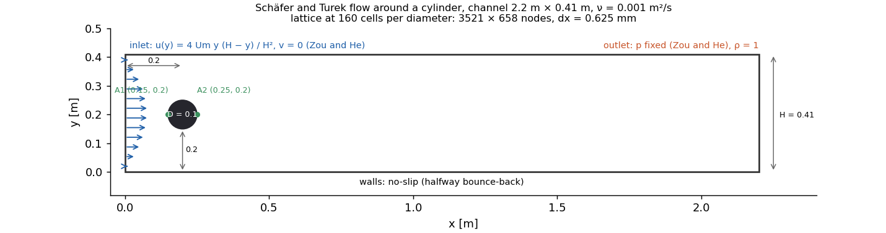

2D-2 at 160 cells per diameter (3521 × 658 nodes), over the last three of 27 consistent shedding periods ([summary](cuda/results/2D-2_N160_fp32/summary.json)), against the FeatFlow 2014 reference results:

| Quantity | Measured | Reference | Error | Paper range |
|---|---:|---:|---:|---|
| cD max | 3.2476 | 3.2274 | +0.62 % | 3.22 to 3.24 |
| cL max | 1.0015 | 0.98658 | +1.51 % | 0.99 to 1.01 |
| St | 0.3017 | 0.30184 | −0.05 % | 0.295 to 0.305 |
| Δp(t0 + T/2) | 2.4841 | 2.4852 | −0.04 % | 2.46 to 2.50 |

The drag peak sits just outside the paper's range. The cylinder is a staircase of cells, which is first-order accurate, and the drag error shrinks steadily with refinement. 2D-1 at 80 cells per diameter gives cD within 0.62 %, cL within 2.97 % and Δp within 0.80 % of the reference.

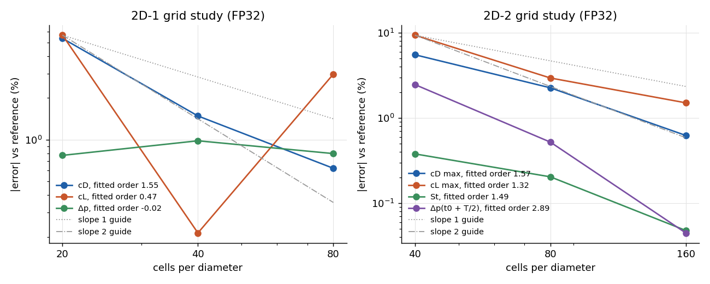

The errors fall with refinement at observed orders of 1.3 to 1.6 for the force peaks. Richardson extrapolation of the 2D-1 drag lands within 0.4 % of the reference, with a grid convergence index of 0.3 % on the finest grid; all quantities are tabulated in [docs/VALIDATION.md](docs/VALIDATION.md).

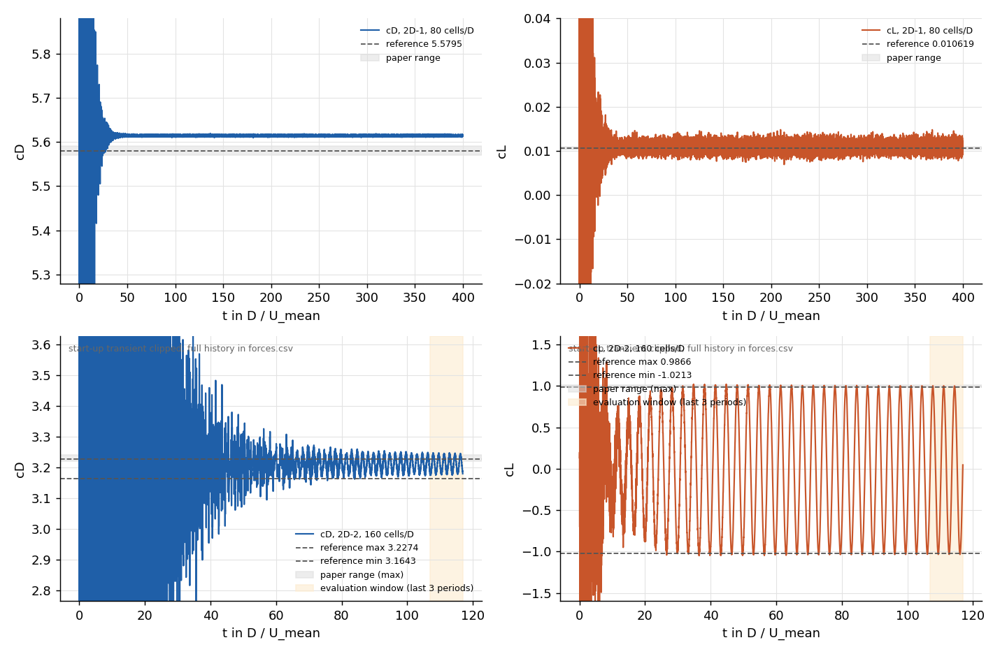

**Plane Poiseuille flow came first.** Before any cylinder run, the empty channel was compared with the analytic parabola at three channel heights. The relative L2 error fell from 4.4e-3 to 2.7e-4 at second order, as it should. That check failed at first: in single precision the finest channel never settled. The viscous stress lives in the tiny difference between the populations and their equilibrium, about 1e-5 on numbers of order 0.4, and single precision lost it to cancellation. Storing each population's deviation from the fluid at rest (Skordos 1993) fixed it without changing any parameter, and double-precision runs confirm the result ([traces](cuda/results/poiseuille_investigation/README.md)).

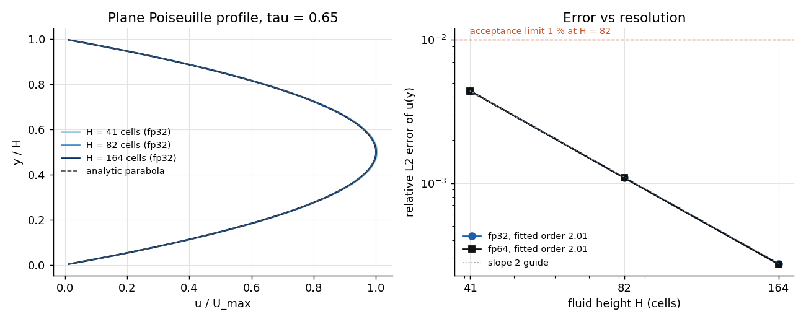

Double-precision builds on three grids differ from single precision by at most 4 % of the change between the two finest grids, so single-precision storage isn't a limiting error. Run headless for the same number of steps, the demo reproduces the benchmark's cD max, cL max and St to 1e-4 % ([check](cuda/results/demo_consistency/consistency.json)), so the window shows what was validated.

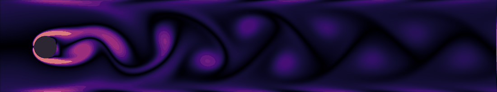

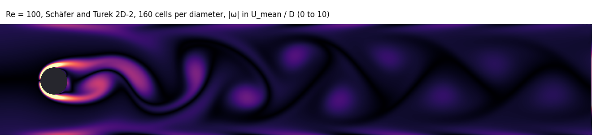

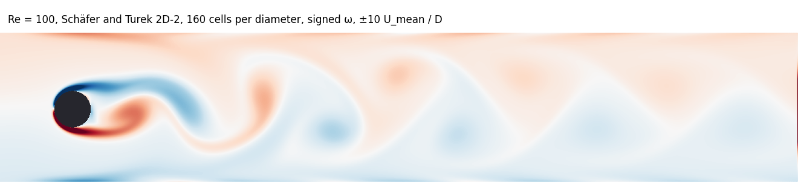

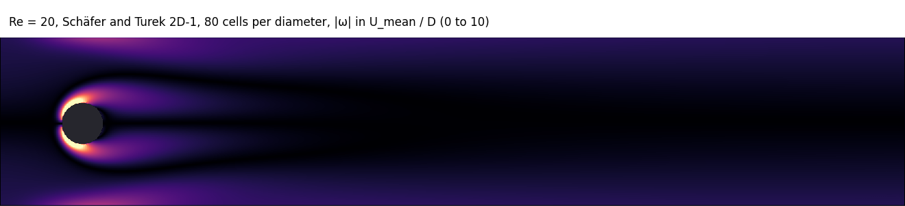

## Performance

| Code | Grid | MLUPS, median |
|---|---|---:|
| CuPy prototype (AoS, CUDA graphs) | 1600 × 400 | 2,126 |
| First CUDA version (SoA) | 1600 × 400 | 3,810 |
| Validated solver, step kernel | 1761 × 330 | 3,844 |
| Validated solver with force and pressure diagnostics | 1761 × 330 | 3,757 |

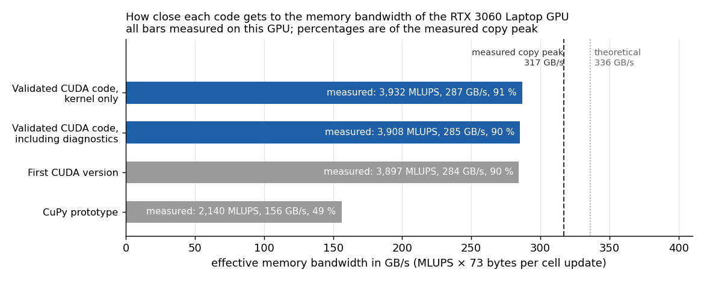

MLUPS is million lattice cell updates per second, timed with CUDA events over five runs of 20,000 steps. At 73 bytes per cell update the solver moves 281 GB/s, 89 % of the 315 GB/s a plain copy kernel reaches on the same GPU. Method, noise and caveats are in [docs/PERFORMANCE.md](docs/PERFORMANCE.md).

## Design highlights

- **One fused kernel per time step.** Each thread pulls its cell's nine incoming populations, applies the boundary conditions, collides and writes nine values to the second buffer. That's one pass over memory, and the buffers swap by pointer.
- **Structure-of-arrays layout.** Each direction has its own array, so neighbouring threads read neighbouring addresses and every access is coalesced.
- **Boundaries inside the kernel.** A 1-byte node type selects fluid, wall, cylinder, inlet or outlet: halfway bounce-back for solids, Zou and He conditions for inlet and outlet. There are no separate boundary kernels.
- **Shifted storage.** The arrays hold deviations from the rest state, which keeps single precision usable at low lattice velocities at no measurable cost.
- **Everything stays on the GPU.** Cylinder forces are reduced with warp shuffles and a double-precision atomic per block, so 80 bytes reach the host every 64 steps. The demo colours the vorticity straight into an OpenGL texture.

The reasoning behind these and the other choices is in [docs/DESIGN_NOTES.md](docs/DESIGN_NOTES.md).

## From prototype to solver

The project started as a CuPy prototype ([python/lbm_cupy.py](python/lbm_cupy.py)) and a direct CUDA port of it. They looked good but weren't a validated solver:

| Issue in the prototype | Effect | Validated solver |
|---|---|---|
| Inlet speed 0.20 in lattice units, Mach 0.35 | large compressibility error, no validated case possible | Mach at or below 0.13, halving with refinement |
| Velocity clamp at 0.45 | hides divergence instead of reporting it | removed; divergence stops the run |
| Density filter | changes mass, and never ran in the CUDA graph path anyway | removed |
| Vorticity factor | the display showed −2ω | ω from central differences, in units of U/D |
| Uniform inlet, periodic top and bottom, random initial noise | not the benchmark's conditions, not reproducible | parabolic Zou and He inlet, pressure outlet, bounce-back walls, analytic initial state |

## Visual showcase (not validated)

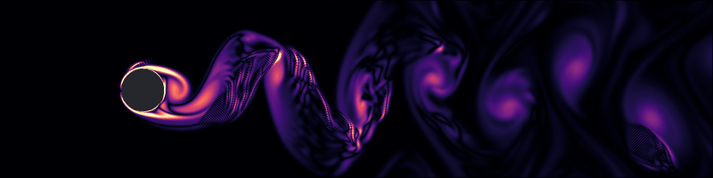

| Start-up transient (steps 0 to 30,000) | Developed shedding |
|:---:|:---:|
| 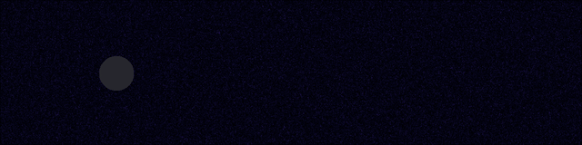 | 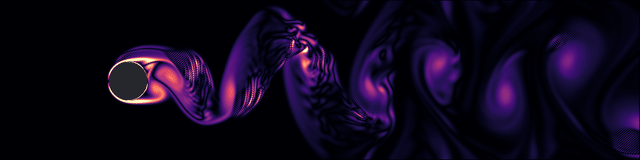 |

Recorded from the CuPy prototype at Re about 823; the full 72,000-step run is in [vortex_street.mp4](docs/media/vortex_street.mp4). The first CUDA version, [cuda/showcase/karman_showcase.cu](cuda/showcase/karman_showcase.cu), ports it with the same parameters and is kept for its look. It runs at lattice Mach 0.35 with a velocity clamp and periodic top and bottom, far outside the range where the method is accurate. No published reference exists for this setup, and real cylinder wakes are three-dimensional above Re about 190. The release includes it as a separate launcher; the validated demo stays the default.

## Limitations

- Two-dimensional only, with a staircase cylinder: the forces converge at about first order.
- BGK collision at tau = 0.56 for Re = 100, close to the stability limit of 0.5. The demo's mode for other Reynolds numbers runs only up to Re 110.
- A fixed-pressure outlet instead of the paper's "do nothing" condition. Pressure waves reflect between inlet and outlet, so periodic runs need at least 12 consistent periods before evaluation.
- In single precision the 2D-1 runs at 40 and 80 cells per diameter keep a small drag ripple and end at the 400 D/U time limit. Their values are 20 D/U time means, and the 80-cell lift moves by about ±0.15 % with the averaging window.
- Double precision was compared on three grids only (2D-1 at 40 and 80, 2D-2 at 80 cells per diameter), and 2D-1 at 160 cells per diameter wasn't run (about 1.9 hours).

## Run it

**Windows, prebuilt:** download the zip from the [latest release](https://github.com/hitesh100299/GPU-Lattice-Boltzmann-Method/releases/latest), unzip it and double-click `run_demo.bat`. It needs only an NVIDIA driver; `run_benchmark.bat` runs a one-minute check against the reference values.

**From source:** `cuda\run.bat` builds and starts the demo with the CUDA toolkit and Visual Studio 2022 Build Tools; on Linux, `make -C cuda`. Developed and tested on Windows; Linux build is compiled in CI but not run on a GPU.

**Reproduce every number:** `bash cuda/tools/reproduce_all.sh` reruns every case and regenerates all figures and tables (about an hour on an RTX 3060 Laptop GPU); `--quick --out tmp` runs a two-minute subset and compares it with the committed results.

Build options, program options and the release details are in [docs/BUILD.md](docs/BUILD.md).

## Repository

- `cuda/lbm_core.cuh` holds the kernels and the simulation object shared by everything; `lbm_bench.cu` is the headless benchmark, `lbm_cuda.cu` the real-time demo, `cases.h` the geometry and reference values.
- `cuda/tools/` has the run, measurement and plotting scripts; `cuda/results/` every log, summary, table and figure; `tests/` two short regression cases.
- `python/lbm_cupy.py` is the original prototype and `cuda/showcase/` the first CUDA version.

## References

- M. Schäfer, S. Turek, Benchmark computations of laminar flow around a cylinder. In: Flow Simulation with High-Performance Computers II, Notes on Numerical Fluid Mechanics 48, Vieweg 1996, pp. 547 to 566. [doi:10.1007/978-3-322-89849-4_39](https://doi.org/10.1007/978-3-322-89849-4_39)
- FeatFlow DFG benchmark pages, TU Dortmund: [2D-1](https://wwwold.mathematik.tu-dortmund.de/~featflow/en/benchmarks/cfdbenchmarking/flow/dfg_benchmark1_re20.html) and [2D-2](https://wwwold.mathematik.tu-dortmund.de/~featflow/en/benchmarks/cfdbenchmarking/flow/dfg_benchmark2_re100.html).
- T. Krüger et al., The Lattice Boltzmann Method: Principles and Practice, Springer 2017.
- Q. Zou, X. He, On pressure and velocity boundary conditions for the lattice Boltzmann BGK model, Physics of Fluids 9, 1591 (1997).
- P. A. Skordos, Initial and boundary conditions for the lattice Boltzmann method, Physical Review E 48, 4823 (1993).
- I. B. Celik et al., Procedure for estimation and reporting of uncertainty due to discretization in CFD applications, Journal of Fluids Engineering 130, 078001 (2008).

License: MIT, see [LICENSE](LICENSE). To cite this work, use GitHub's "Cite this repository" button, generated from [CITATION.cff](CITATION.cff).
